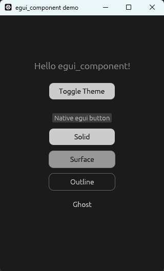
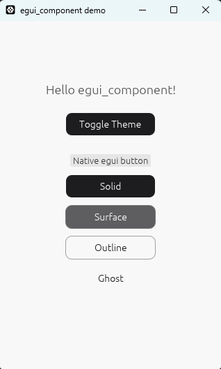

# egui_component

[English](README.md) | [中文](README.zh.md)

[](https://crates.io/crates/egui_component)
[](LICENSE)

[Live demo & docs](https://march-mitsuki.github.io/egui_component/)





## 🚀 Introduction

**egui_component** is a modern, non-intrusive component library built specifically for [egui](https://github.com/emilk/egui). It provides a set of preset component styles and a comprehensive styling system, offering out-of-the-box utility while giving developers full control over component appearance.

Thanks to its non-intrusive design, you can seamlessly use it in any `eframe` or custom `egui` framework without modifying your existing UI architecture.

## ✨ Features

- **🧩 Non-Intrusive**: Does not force a takeover of global `Visuals`; can coexist perfectly with native egui controls.
- **✨ Modern Styling**: Out-of-the-box modern component styles to enhance your application's visual quality.
- **🎨 Flexible Styling System**: Highly decoupled; every visual attribute of each component is fully customizable.
- **🌓 Color Mode Friendly**: Native support for dark/light mode switching.

## 📦 Installation

Add the following dependency to your `Cargo.toml` file:

```toml
[dependencies]
egui_component = "0.3.0"
```

### Optional Lucide icons

Enable `lucide_icon` for the complete vendored Lucide SVG set:

```toml
egui_component = { version = "0.3.0", features = ["lucide_icon"] }
```

```rust
use egui_component::icon::lucide;

let heart = lucide::HEART;
let arrow = lucide::get("arrow-down").unwrap();
// lucide::NAMES lists all available upstream names.
```

Pass these image sources to the icon/button components as usual. SVG strokes are
white so egui tinting controls their color; transparent fills stay transparent.
Without this feature, only the existing `icon::ICONS` set is compiled in.
Call `egui_extras::install_image_loaders(ctx)` once to enable SVG rendering.
Assets are bundled in the crate; builds and applications do not download icons.

## 📝 Quick Start

`egui_component` follows egui's Immediate Mode design philosophy. If you are familiar with egui, getting started will feel very natural.

```rust
use egui_component::components::button;
use egui_component::theme::{UiTheme, ColorMode};

fn my_page(ui: &mut egui::Ui) {
    // 1. Load theme configuration (Recommended to load once during app initialization and store in global or persistent state)
    // Example code assumes you have a valid theme.json
    let ui_theme = UiTheme::from_json_bytes(include_bytes!("theme.json")).unwrap();

    // 2. Select the current color mode (e.g., using the dark theme)
    let theme = &ui_theme.dark;

    ui.horizontal(|ui| {
        // Use built-in presets for quick rendering and interaction handling
        if button::render(ui, "Solid", button::Style::new_solid_md(theme)).clicked() {
            println!("Solid button clicked!");
        }

        button::render(ui, "Surface", button::Style::new_surface_md(theme));
        button::render(ui, "Outline", button::Style::new_outline_md(theme));
        button::render(ui, "Ghost", button::Style::new_ghost_md(theme));
    });
}
```

## 📖 Examples

See `examples/` for more examples. Explore components in the [online gallery](https://march-mitsuki.github.io/egui_component/), or run the native gallery from the repository root:

```sh
cargo run --example gallery
```

For local browser setup and builds, see the [contribution guide](CONTRIBUTE.md#development-setup).

### Dynamic fonts

Use egui's default fonts, or load bundled or runtime font bytes through `FONT_MANAGER`. Call `FONT_MANAGER.apply(ctx)` during each egui UI pass before rendering components, and perform font family lookups within the UI pass.

```rust,ignore
use egui_component::consts::{DEFAULT_FONT_FAMILY_ALIAS, FONT_MANAGER};
use egui_component::font::weight::FontWeight;

// After downloading or reading font bytes (application-owned I/O):
FONT_MANAGER.replace_family(DEFAULT_FONT_FAMILY_ALIAS, &[
    (regular_bytes.as_slice(), 0),
    (bold_bytes.as_slice(), 0),
])?;
FONT_MANAGER.load_from_bytes("cjk", &cjk_bytes, 0)?;
FONT_MANAGER.set_fallback_chain(&["cjk"]);
ctx.request_repaint(); // Wake an idle application after asynchronous loading.

// During the UI pass, before rendering components:
FONT_MANAGER.apply(ctx);
let family = FONT_MANAGER.get_egui_font_family(ctx, DEFAULT_FONT_FAMILY_ALIAS, FontWeight::Bold);
```

Use `replace_family` to replace a whole family, `load_from_bytes` to add or replace a single font, and `set_fallback_chain` to configure missing-character fallback. Remove fonts with `remove_face` or `remove_family`. After asynchronous loading, call `ctx.request_repaint()` to display the update.

File and system font loading are native-only; Web applications should supply font bytes. Provide existing application fonts through `FontManager::with_base_fonts` or `set_base_fonts`, then let that manager handle subsequent Context font updates.

The gallery's **Text** page demonstrates font switching, fallback, and loading fonts from a URL.

## 🌍 Who's using egui_component ?

- [ChiyoCast](https://chiyocast.com): cloud-native streaming software custom-built for next-gen creators.

If you're using egui_component too, feel free to open an issue to get your project listed here!

## Contributing

Contributions are welcome; see [the contribution guide](CONTRIBUTE.md).

## 📄 LICENSE

This repository and all its included packages are released under the **MIT License**.
