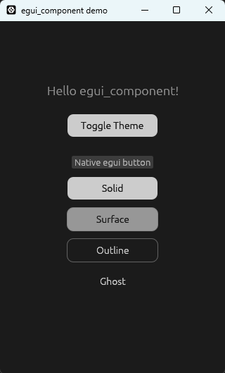
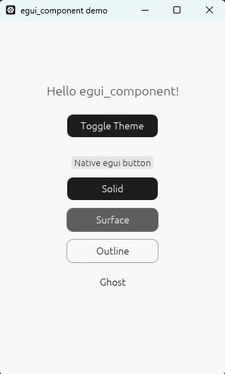

# egui_component

[English](README.md) | [中文](README.zh.md)

[](https://crates.io/crates/egui_component)
[](LICENSE)





## 🚀 简介

**egui_component** 是一个专为 [egui](https://github.com/emilk/egui) 打造的现代化、非侵入式组件库。它同时提供了一套预设的组件样式和一个功能完善的样式系统，在开箱即用的同时开发者也有完全控制组件外观的能力。

并且得益于非侵入式设计，你可以无缝地在任何 `eframe` 或自定义 `egui` 框架中使用它，而无需修改现有的 UI 架构。

## ✨ 特性

- **🧩 非侵入式 (Non-Intrusive)**：不强制接管全局 `Visuals`，可以与原生 egui 控件完美并存。
- **✨ 现代样式**： 开箱即用的现代组件样式，提升应用视觉质感。
- **🎨 灵活的样式系统**：高度解耦，每个组件的视觉属性均可完全自定义。
- **🌓 颜色模式友好**：原生支持深色/浅色模式切换。

## 📦 安装

### 稳定版 (从 crates.io 中安装)
将以下依赖添加到你的 `Cargo.toml` 文件中：

```toml
[dependencies]
egui_component = "0.2.0"
```

### 先行版 (直接添加我们的 dev branch)
将以下依赖添加到你的 `Cargo.toml` 文件中：

```toml
egui_component = { git = "https://github.com/March-mitsuki/egui_component", branch = "dev" }
```

### 可选 Lucide 图标

启用 `lucide_icon` feature 即可使用完整的 Lucide SVG 图标集：

```toml
egui_component = { version = "0.1.0-alpha.2", features = ["lucide_icon"] }
```

```rust
use egui_component::icon::lucide;

let heart = lucide::HEART;
let arrow = lucide::get("arrow-down").unwrap();
// lucide::NAMES 包含所有上游图标名称。
```

这些图像源可以直接传给现有图标和按钮组件。SVG 描边使用白色，支持 egui
的 tint 着色，透明填充保持不变。不开启 feature 时，只编译现有的 `icon::ICONS`。
初始化时调用一次 `egui_extras::install_image_loaders(ctx)` 以支持 SVG 渲染。
图标随 crate 分发，构建和运行时均不需要下载。

维护者运行 `python3 scripts/update_lucide_icons.py` 可重现固定版本，添加
`--ref main`（或 tag/commit）可更新。请一起提交生成的 `src/icon/lucide.rs`
和 `assets/lucide/`。上游 commit 记录在 `assets/lucide/source.json`，完整保留
Lucide ISC 和 Feather MIT 声明，见 [assets/lucide/LICENSE](assets/lucide/LICENSE)。

## 📝 快速开始

`egui_component` 遵循 egui 的立即模式（Immediate Mode）设计哲学。如果你熟悉 egui，上手将非常自然。

```rust
use egui_component::components::button;
use egui_component::theme::{UiTheme, ColorMode};

fn my_page(ui: &mut egui::Ui) {
    // 1. 加载主题配置 (建议在应用初始化时加载一次并存储在全局或持久化状态中)
    // 示例代码假定你有一个合法的 theme.json
    let ui_theme = UiTheme::from_json_bytes(include_bytes!("theme.json")).unwrap();

    // 2. 选择当前使用的颜色模式（例如使用暗色主题）
    let theme = &ui_theme.dark;

    ui.horizontal(|ui| {
        // 使用内置的预设样式快速渲染并处理交互
        if button::render(ui, "Solid", button::Style::new_solid_md(theme)).clicked() {
            println!("Solid button clicked!");
        }

        button::render(ui, "Surface", button::Style::new_surface_md(theme));
        button::render(ui, "Outline", button::Style::new_outline_md(theme));
        button::render(ui, "Ghost", button::Style::new_ghost_md(theme));
    });
}
```

## 📖 示例

更多示例请查看 `examples/` 目录。

### 在浏览器中运行 Gallery

安装 WASM target 和 [Trunk](https://github.com/trunk-rs/trunk)，然后在仓库根目录运行：

```sh
rustup target add wasm32-unknown-unknown
cargo install trunk --locked
trunk serve
```

打开 <http://127.0.0.1:8080>。运行 `trunk build --release` 可在 `dist/` 生成静态网站。
Web Gallery 使用 WebGL，先以默认字体显示页面，再从 GitHub 异步下载多语言字体。右下角 Toast 显示下载进度，失败时可重试；桌面版使用相同的后台下载、进度提示和失败重试流程。
桌面版本使用 `cargo run --example gallery` 运行。

应用可以直接使用 egui 默认字体，也可以先通过 `FONT_MANAGER.load_from_bytes` 加载内嵌字体，再调用 `FONT_MANAGER.set_egui_fonts(&cc.egui_ctx)`。文件和系统字体加载仅供原生平台使用；主题 JSON 可在两个平台上通过 `UiTheme::from_json_bytes` 加载。

### 动态字体

每帧渲染组件前调用 `FONT_MANAGER.apply(ui.ctx())`。未变化的版本会按 Context 分别跳过，`set_egui_fonts` 也可继续用于提交更新。egui 在下一次 pass 启用新字体；查询始终使用当前 Context 已生效的字体，避免引用尚未注册的字体名称。

```rust,ignore
use egui_component::consts::{DEFAULT_FONT_FAMILY_ALIAS, FONT_MANAGER};
use egui_component::font::weight::FontWeight;

// 应用完成下载或读取字体后，将字节交给管理器：
FONT_MANAGER.replace_family(DEFAULT_FONT_FAMILY_ALIAS, &[
    (regular_bytes.as_slice(), 0),
    (bold_bytes.as_slice(), 0),
])?;
FONT_MANAGER.load_from_bytes("cjk", &cjk_bytes, 0)?;
FONT_MANAGER.set_fallback_chain(&["cjk"]);
ctx.request_repaint(); // 异步加载完成后唤醒空闲的应用。

// 在 UI pass 中，渲染组件之前：
FONT_MANAGER.apply(ctx);
let family = FONT_MANAGER.get_egui_font_family(ctx, DEFAULT_FONT_FAMILY_ALIAS, FontWeight::Bold);
```

`load_from_bytes` 替换同一 family、字重及斜体样式的 face。`replace_family` 验证整组字体后一次性替换；解析失败、空批次、重复字重/样式都不会修改旧字体。通过 `remove_face`、`remove_family` 删除的字体会在下次 `apply` 时提交。缺字时依次使用 fallback 链中各 family 的相近字重，最后使用基础比例字体。常规体与斜体分别存储，`get_egui_font_family_with_style` 可选择样式。

字体查询方法现在需要以 `&egui::Context` 为第一个参数，并在 egui pass 中调用。独立的 `FontManager` 可以通过自己的查询方法服务多个 Context；组件使用全局 `FONT_MANAGER`。每个 Context 应由一个字体管理器负责；应用自定义字体可通过 `FontManager::with_base_fonts(definitions)` 或 `set_base_fonts` 提供，之后不要再独立覆盖 Context 的字体。管理器不会修改基础 `Proportional`、`Monospace` 字体链。

Gallery 的 **Text** 页面可以运行时切换字体、开关中文 fallback、删除主字体，以及尝试加载错误字体。

该页面也支持输入 HTTP(S) 字体文件直链，通过 `ehttp` 异步下载。默认使用 Google Fonts 的 Black Ops One Latin 字体地址：粘贴字体 URL，再点击 **Load font**。Gallery 使用 `wuff` 将 WOFF2 解压为 OpenType，再调用 `replace_family`；这些依赖仅用于示例。TTF/OTF/TTC 字节直接交给管理器。下载或解析失败时保留当前字体；取消或切换其他字体后，迟到的下载结果不会覆盖新选择。Web 下载需要字体服务器允许 CORS。Google Fonts 的链接可能只包含部分字符，缺少的字符仍会使用配置的 fallback 链。

## 🌍 谁在用 egui_component ?

- [ChiyoCast](https://chiyocast.com): 为次世代直播量身定制的云原生直播软件。

如果你也在用 egui_component, 欢迎提交 issue 添加你的项目到这里！

## 📄 LICENSE

本仓库及其包含的所有包均在 **MIT License** 下发布。


### Gallery 主页

运行 `cargo run --example gallery` 启动原生应用；运行 `trunk serve` 后访问
`http://127.0.0.1:8080/` 使用 Web 版本。Home、Docs、Components 共用页头，
文档和组件页采用左侧导航、正文、右侧页内目录的布局，窄窗口下导航自动折叠。
页面使用 `egui_component_router`，例如 `/components/button?section=usage`。
生产环境需要将页面请求回退至 `index.html`，由应用显示未知路径的 404 页面。


### 品牌主题颜色

`examples/theme.json` 分别配置明暗主题。`colors.primary.l6` 为主题色，
`colors.bg.base` 为页面背景，`colors.fg.base` 为正文字色，颜色使用 RGBA 字节数组。
目前亮色为 `#6B65F5` / `#FFFFFF` / `#202124`，暗色为
`#8B85FF` / `#101318` / `#F6F7FB`。

色阶可选的 `foreground` 字段控制实心彩色按钮的文字及图标颜色，主色色阶也用于
Switch 的滑块颜色。旧 JSON 不需要增加该字段；省略时沿用原先默认值。
`ICONS.logo_light` 和 `ICONS.logo_dark` 提供品牌 SVG，搭配 icon 组件时使用白色 tint 保留原色。

Gallery 的 `/zh/theme-generator` 页面提供主题生成器：选择品牌色、预览明暗主题、编辑高级配置，并导出兼容 `UiTheme` 的 JSON。库中也提供 `theme_gen::generate`，以及支持独立或受控展开状态的 `components::accordion` 折叠面板。

生成器统一使用库内组件，包括 `slider`、`color_picker`、`segmented_control` 和 `text_edit::render_multiline`。数值编辑复用普通 TextEdit，由页面负责解析，不单独提供 NumberInput 组件。
