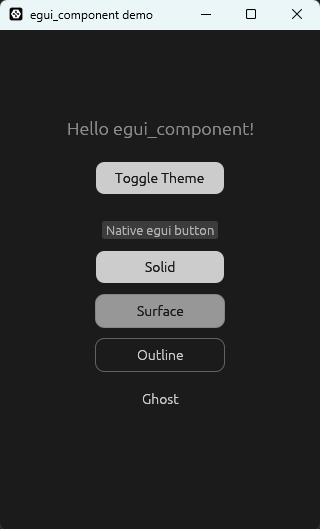
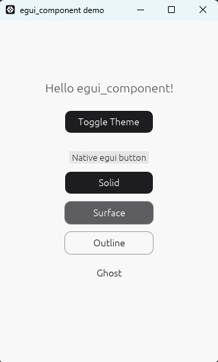

# egui_component

[English](README.md) | [中文](README.zh.md)

[](https://crates.io/crates/egui_component)
[](LICENSE)

[实际案例 & 开发文档](https://march-mitsuki.github.io/egui_component/)





## 🚀 简介

**egui_component** 是一个专为 [egui](https://github.com/emilk/egui) 打造的现代化、非侵入式组件库。它同时提供了一套预设的组件样式和一个功能完善的样式系统，在开箱即用的同时开发者也有完全控制组件外观的能力。

并且得益于非侵入式设计，你可以无缝地在任何 `eframe` 或自定义 `egui` 框架中使用它，而无需修改现有的 UI 架构。

## ✨ 特性

- **🧩 非侵入式 (Non-Intrusive)**：不强制接管全局 `Visuals`，可以与原生 egui 控件完美并存。
- **✨ 现代样式**： 开箱即用的现代组件样式，提升应用视觉质感。
- **🎨 灵活的样式系统**：高度解耦，每个组件的视觉属性均可完全自定义。
- **🌓 颜色模式友好**：原生支持深色/浅色模式切换。

## 📦 安装

### 稳定版 (从 crates.io 中安装)
将以下依赖添加到你的 `Cargo.toml` 文件中：

```toml
[dependencies]
egui_component = "0.3.0"
```

### 先行版 (直接添加我们的 dev branch)
将以下依赖添加到你的 `Cargo.toml` 文件中：

```toml
egui_component = { git = "https://github.com/March-mitsuki/egui_component", branch = "dev" }
```

### 可选 Lucide 图标

启用 `lucide_icon` feature 即可使用完整的 Lucide SVG 图标集：

```toml
egui_component = { version = "0.3.0", features = ["lucide_icon"] }
```

```rust
use egui_component::icon::lucide;

let heart = lucide::HEART;
let arrow = lucide::get("arrow-down").unwrap();
// lucide::NAMES 包含所有上游图标名称。
```

这些图像源可以直接传给现有图标和按钮组件。SVG 描边使用白色，支持 egui
的 tint 着色，透明填充保持不变。不开启 feature 时，只编译现有的 `icon::ICONS`。
初始化时调用一次 `egui_extras::install_image_loaders(ctx)` 以支持 SVG 渲染。
图标随 crate 分发，构建和运行时均不需要下载。

## 📝 快速开始

`egui_component` 遵循 egui 的立即模式（Immediate Mode）设计哲学。如果你熟悉 egui，上手将非常自然。

```rust
use egui_component::components::button;
use egui_component::theme::{UiTheme, ColorMode};

fn my_page(ui: &mut egui::Ui) {
    // 1. 加载主题配置 (建议在应用初始化时加载一次并存储在全局或持久化状态中)
    // 示例代码假定你有一个合法的 theme.json
    let ui_theme = UiTheme::from_json_bytes(include_bytes!("theme.json")).unwrap();

    // 2. 选择当前使用的颜色模式（例如使用暗色主题）
    let theme = &ui_theme.dark;

    ui.horizontal(|ui| {
        // 使用内置的预设样式快速渲染并处理交互
        if button::render(ui, "Solid", button::Style::new_solid_md(theme)).clicked() {
            println!("Solid button clicked!");
        }

        button::render(ui, "Surface", button::Style::new_surface_md(theme));
        button::render(ui, "Outline", button::Style::new_outline_md(theme));
        button::render(ui, "Ghost", button::Style::new_ghost_md(theme));
    });
}
```

## 📖 示例

更多示例请查看 `examples/` 目录。可以通过[在线 Gallery](https://march-mitsuki.github.io/egui_component/)体验组件，也可以在仓库根目录运行桌面版：

```sh
cargo run --example gallery
```

浏览器版的本地运行与构建方法见[贡献指南](CONTRIBUTE.zh.md#开发环境)。

### 动态字体

应用可以使用 egui 默认字体，也可以通过 `FONT_MANAGER` 加载内嵌字体或运行时获取的字体字节。每帧在 egui UI pass 中、渲染组件之前调用 `FONT_MANAGER.apply(ctx)`；字体查询方法也应在 UI pass 中调用。

```rust,ignore
use egui_component::consts::{DEFAULT_FONT_FAMILY_ALIAS, FONT_MANAGER};
use egui_component::font::weight::FontWeight;

// 应用完成下载或读取字体后，将字节交给管理器：
FONT_MANAGER.replace_family(DEFAULT_FONT_FAMILY_ALIAS, &[
    (regular_bytes.as_slice(), 0),
    (bold_bytes.as_slice(), 0),
])?;
FONT_MANAGER.load_from_bytes("cjk", &cjk_bytes, 0)?;
FONT_MANAGER.set_fallback_chain(&["cjk"]);
ctx.request_repaint(); // 异步加载完成后唤醒空闲的应用。

// 在 UI pass 中，渲染组件之前：
FONT_MANAGER.apply(ctx);
let family = FONT_MANAGER.get_egui_font_family(ctx, DEFAULT_FONT_FAMILY_ALIAS, FontWeight::Bold);
```

使用 `replace_family` 替换整个字体族，使用 `load_from_bytes` 添加或替换单个字体，使用 `set_fallback_chain` 配置缺字回退。可通过 `remove_face` 或 `remove_family` 删除字体。异步加载完成后调用 `ctx.request_repaint()`，让应用显示更新。

文件和系统字体加载仅支持原生平台；Web 应用请传入字体字节。应用已有的字体可通过 `FontManager::with_base_fonts` 或 `set_base_fonts` 提供，之后统一由该管理器更新 Context 字体。

Gallery 的 **Text** 页面提供字体切换、缺字回退和字体 URL 加载示例。

## 🌍 谁在用 egui_component ?

- [ChiyoCast](https://chiyocast.com): 为次世代直播量身定制的云原生直播软件。

如果你也在用 egui_component, 欢迎提交 issue 添加你的项目到这里！

## 参与贡献

欢迎参与贡献，详见[贡献指南](CONTRIBUTE.zh.md)。

## 📄 LICENSE

本仓库及其包含的所有包均在 **MIT License** 下发布。
